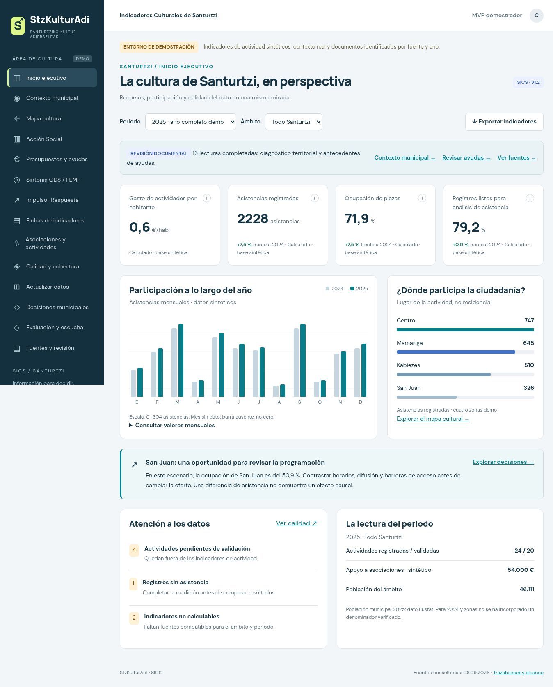
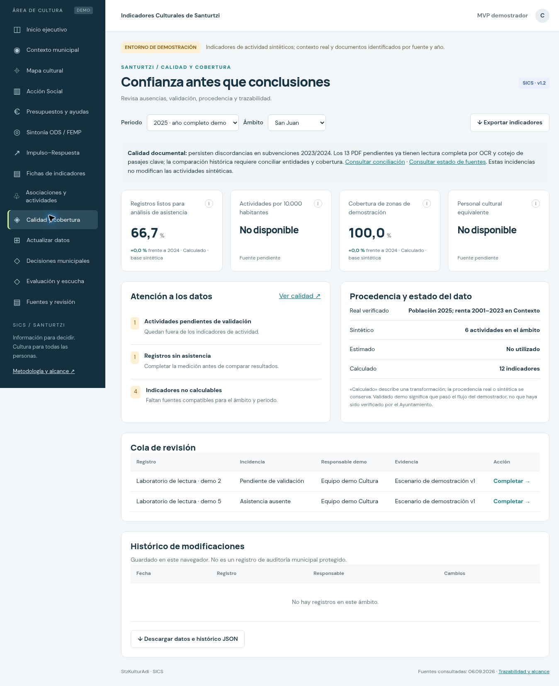
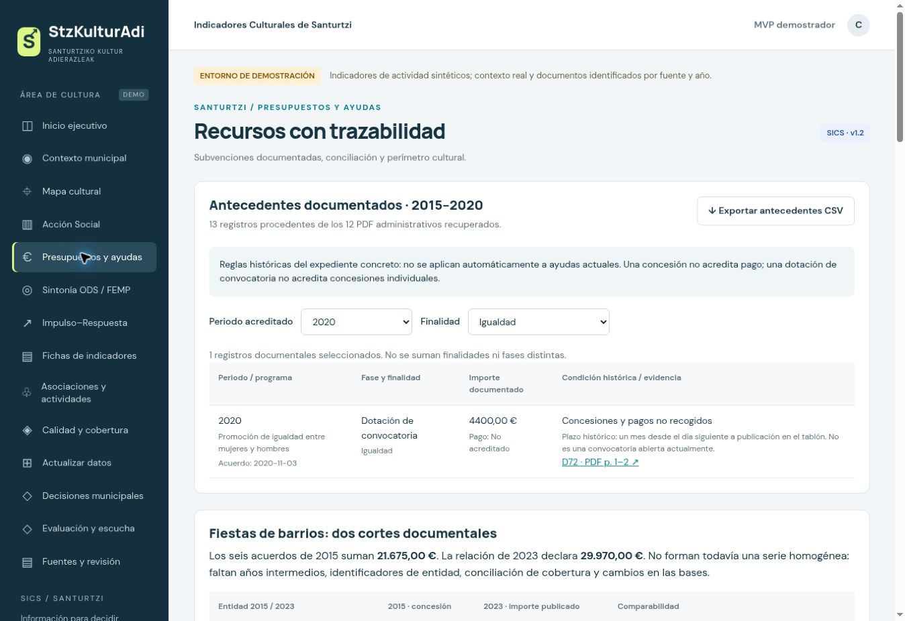

# StzKulturAdi · Indicadores culturales de Santurtzi

**Santurtziko Kultur Adierazleak** · Proyecto de portafolio de [Joseph / JsphLynx](https://github.com/JsphLynx)

Un MVP que convierte registros de actividad y fuentes documentales en indicadores explicables para apoyar decisiones de gestión cultural: **qué medir, con qué datos y con qué límites**.

**JavaScript · HTML · CSS · Business Analytics · Calidad del dato · Diseño de indicadores**

[Caso de negocio](docs/CASO_DE_NEGOCIO.md) · [Arquitectura](docs/ARQUITECTURA.md) · [Datos y metodología](docs/DATOS_Y_METODOLOGIA.md) · [Guía de demostración](docs/DEMOSTRACION.md) · [English overview](docs/OVERVIEW_EN.md)

> **Estado: MVP demostrador v1.2.** Actividades y asociaciones sintéticas; contexto real y antecedentes documentales identificados por fuente y año. No es un servicio municipal en producción ni acredita aprobación del Ayuntamiento. PostgreSQL/PostGIS e integración SIACS pertenecen al diseño del futuro piloto.



*Captura de la versión 1.2, realizada el 07/09/2026. Las cifras de actividad son de demostración.*

## El proyecto en un minuto

| Pregunta | Respuesta |
|---|---|
| ¿Qué problema aborda? | Información cultural dispersa, periodos incompatibles y cifras cuya fuente, fórmula o validación no están claras. |
| ¿Para quién se diseña? | Equipos de Cultura, responsables de gestión y perfiles de análisis municipal. |
| ¿Qué entrega? | Un cuadro de indicadores navegable, registro local, revisión de fuentes, exportaciones y una propuesta de piloto evaluable. |
| ¿Qué lo distingue? | Conserva las ausencias y discrepancias; separa asistencia de personas únicas, concesión de pago y dato real de dato sintético. |
| ¿Qué puede revisar un reclutador? | Código completo del MVP, pruebas de cálculo, casos de decisión, capturas y documentación funcional. |

## Capacidades demostradas

- **Análisis de negocio:** problema, usuarios, decisiones, requisitos y criterios de aceptación del piloto.
- **Analítica y calidad:** 16 fichas de indicadores; filtros por año y zona; denominadores compatibles; tratamiento explícito de datos ausentes.
- **Revisión documental:** catálogo de 82 documentos; procedencia, periodo y estado de lectura; discrepancias económicas conservadas.
- **Desarrollo web:** módulos JavaScript, interfaz adaptable, formularios, validaciones, `localStorage` y exportaciones CSV/JSON.
- **Diseño de evolución:** propuesta de persistencia, permisos, trazabilidad y modelo relacional para un piloto municipal.

El trabajo se desarrolló con apoyo de IA generativa. El repositorio permite inspeccionar las decisiones y el resultado; no atribuye al MVP modelos de machine learning, integraciones ni resultados de impacto que no existen.

## Ejecutar la aplicación

Requisitos: Git, Python 3 y un navegador moderno. No requiere instalar paquetes ni compilar.

Para evaluar el proyecto sin acceso a esa instancia, utiliza el código local o el [recorrido visual en PDF](docs/pdf/04_Demostracion_StzKulturAdi.pdf).

## Un caso reproducible: San Juan

Con los datos iniciales, selecciona **2025 → San Juan → Calidad y cobertura**:

| Resultado demo | Cálculo | Interpretación |
|---|---|---|
| 326 asistencias | 51 + 112 + 51 + 112 | Asistencias a actividades, no personas únicas. |
| 50,9 % de ocupación | 326 / 640 × 100 | Se excluyen asistencia y aforo de los registros sin par completo o pendientes de validación. |
| 66,7 % de preparación del dato | 4 / 6 × 100 | Dos registros requieren revisión: uno pendiente y otro sin asistencia. |
| Gasto por habitante: sin dato | No existe población zonal compatible | No se usa la población municipal como sustituto. |

La decisión propuesta es completar la información y contrastar horarios, difusión y barreras antes de modificar la programación. El escenario no demuestra un problema real del barrio ni un efecto causal.

## Vistas del MVP

| Calidad y cobertura | Revisión de ayudas |
|---|---|
|  |  |

[Ver las cinco capturas y el recorrido](docs/DEMOSTRACION.md).

## Tecnología y alcance

| Implementado | Propuesto para el piloto |
|---|---|
| HTML5, CSS y JavaScript con módulos ES | API con autenticación y permisos por rol |
| Motor de cálculo separado de las vistas | PostgreSQL y trazabilidad de observaciones |
| Guardado e histórico local del navegador | Auditoría protegida, copias y restauración |
| Instantáneas documentales; SIACS simulado | Cargas controladas e integración SIACS |
| Cuatro zonas ilustrativas y mapa base OSM | Catálogo territorial y geometrías PostGIS oficiales |

No hay backend municipal, acceso multiusuario, sincronización automática, IA conectada ni medición de satisfacción real. A4 y S4 permanecen sin dato. Los beneficios de ahorro de tiempo y mejora de decisiones están **pendientes de medir**.

## Pruebas reproducibles

Con Node.js 22 o superior:

```bash
npm test
```

No requiere `npm install`: las pruebas usan `node:test` y `node:assert`. Comprueban resultados de referencia, ausencias frente a cero, tasas ponderadas, exclusión de registros pendientes, validaciones y coherencia documental. [Alcance y límites de la verificación](docs/VERIFICACION.md).

## Documentación

| Documento | Para qué leerlo |
|---|---|
| [Resumen ejecutivo · PDF](docs/pdf/01_Resumen_Ejecutivo_StzKulturAdi.pdf) | Problema, propuesta de valor y alcance. |
| [Memoria del proyecto · PDF](docs/pdf/02_Memoria_Proyecto_StzKulturAdi.pdf) | Fórmulas, procedencia, funcionalidades y arquitectura propuesta. |
| [Propuesta de piloto · PDF](docs/pdf/03_Propuesta_Piloto_StzKulturAdi.pdf) | Plan orientativo de diez semanas, responsabilidades y aceptación. |
| [Demostración · PDF](docs/pdf/04_Demostracion_StzKulturAdi.pdf) | Recorrido de siete páginas con evidencias y cálculos. |
| [Roadmap](docs/ROADMAP.md) | Qué existe y qué falta para una operación municipal. |
| [Acta de revisión](docs/revision/cierre_13_lecturas.md) | Alcance de las lecturas y correcciones documentales previas. |

## Organización del repositorio

| Ruta | Contenido |
|---|---|
| `app/` | Aplicación original v1.2, lista para servir por HTTP. |
| `tests/` | Pruebas automatizadas del motor y las fuentes incorporadas. |
| `assets/screenshots/` | Cinco capturas originales del MVP. |
| `docs/` | Caso de negocio, arquitectura, método y guía de evaluación. |
| `docs/pdf/` | Cuatro documentos de presentación de septiembre de 2026. |
| `docs/revision/` | Evidencias heredadas de la revisión documental. |

**Autor del proyecto:** Joseph · [Perfil de GitHub](https://github.com/JsphLynx). Proyecto de portafolio sobre análisis de negocio, datos y gestión cultural; sin afiliación institucional acreditada. Consulta [procedencia y condiciones de uso](NOTICE.md).
