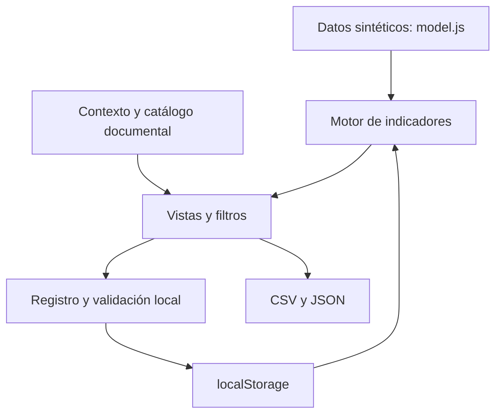

# Arquitectura: implementación y evolución

[Volver al proyecto](../README.md)

## Implementación actual

Aplicación estática en español con módulos ES, sin dependencias JavaScript externas de ejecución. Un servidor HTTP entrega los archivos; cálculo, navegación, formularios y exportaciones se ejecutan en el navegador. El mapa incorpora un recurso externo de OpenStreetMap.

| Archivo | Responsabilidad |
|---|---|
| `app/index.html` | Estructura, navegación accesible y carga de módulos |
| `app/styles.css` | Estilos y adaptación de la interfaz |
| `app/model.js` | Datos demo, selección, indicadores y reglas de validación |
| `app/app.js` | Estado, navegación, vistas principales, formularios y exportaciones |
| `app/review-data.js` | Renta, ayudas y referencias de contexto |
| `app/review-views.js` | Vistas y filtros de revisión documental |
| `app/source-catalog.js` | Inventario y estado de lectura de las fuentes |
| `app/historical-review.js` | Antecedentes administrativos y diagnóstico territorial |

La clave `stz-v1` conserva actividades e histórico en el almacenamiento del origen del navegador. No existe una base de datos compartida ni permisos diferenciados. Las tasas se recalculan desde los registros; las ayudas documentales no sustituyen la instantánea asociativa sintética de A3.

## Modelo lógico del demostrador

Cada actividad contiene identificador, año, mes, zona, asociación, equipamiento, aforo, asistencia, coste, condiciones de acceso, métricas de difusión, horas, fuente, responsable, evidencia, estado y fecha. La asociación se referencia por identificador; zona y equipamiento se conservan como valores del escenario.

No hay tablas SQL, claves foráneas de base de datos ni migraciones implementadas. La integridad se aplica mediante validaciones JavaScript dentro de la demo.

## Diseño propuesto para el piloto

| Componente | Responsabilidad propuesta |
|---|---|
| Interfaz + API | Separar registro, validación y lectura según permisos |
| PostgreSQL | Actividades, sesiones, medidas, fuentes y resultados reproducibles |
| PostGIS | Geometrías y catálogo territorial oficial, cuando estén disponibles |
| Cargas controladas | Validar SIACS y otras fuentes en preparación antes de incorporar |
| Auditoría y operación | Identidad, historial protegido, copias y restauración |

Las entidades propuestas incluyen `asociacion_ref`, `zona`, `equipamiento`, `servicio`, `actividad`, `sesion`, `participacion`, `campana`, `uso_espacio`, `expediente_ayuda`, `fase_importe`, `fuente`, `evidencia`, `validacion`, `indicador`, `formula_version`, `resultado` y `auditoria`. Su esquema físico, restricciones y migraciones siguen pendientes.

## Límites de seguridad y operación

El servidor Python indicado en el README sirve la demo en el equipo local. No se plantea como despliegue de producción. No cargar información sensible en el navegador ni asumir que el histórico local es una evidencia protegida.

Un piloto operativo necesita identidad, autorización de servidor, validación de entradas, tratamiento de exportaciones, política de conservación, monitorización y una prueba de restauración. No se ha realizado una auditoría completa de seguridad, accesibilidad o concurrencia del MVP.
