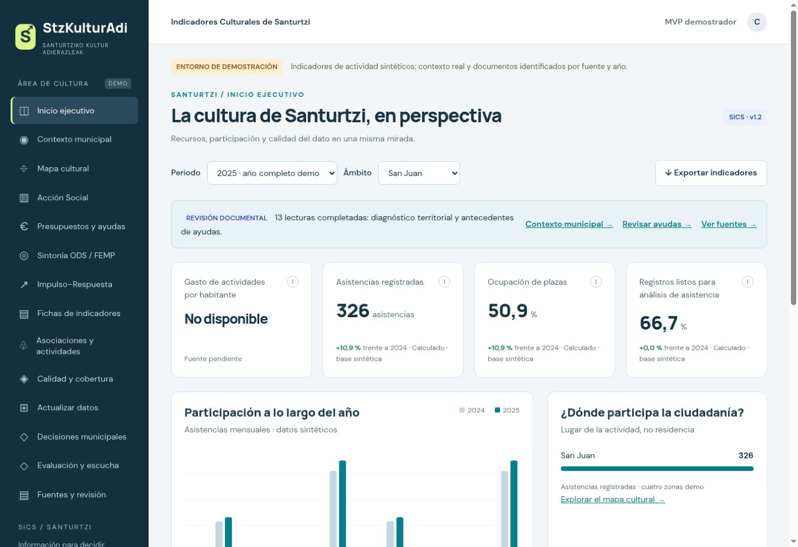
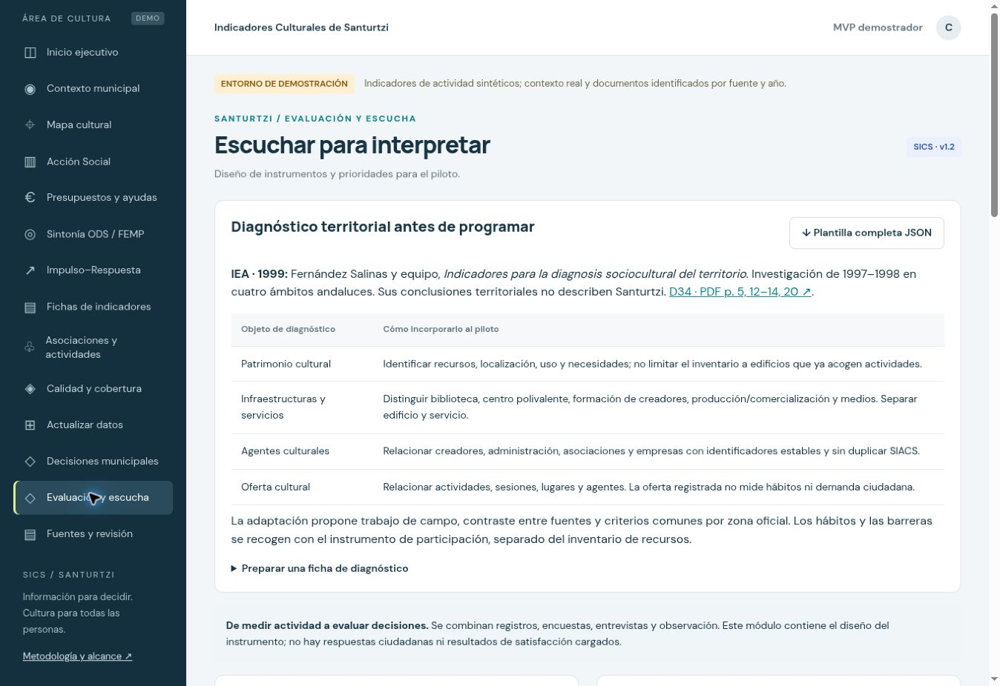

# Recorrido de evaluación · cinco minutos

[Volver al proyecto](../README.md)

Ejecuta la demo con las instrucciones del README. Para reproducir cifras, utiliza los datos iniciales. Si ya has editado registros en ese origen, abre un perfil de navegador nuevo o elimina únicamente la clave `stz-v1` de su almacenamiento local; esa eliminación descarta las ediciones e histórico de la demo en ese origen. Exporta antes cualquier trabajo que quieras conservar.

## 1. Comprender el conjunto

Abre Inicio ejecutivo, 2025, Todo Santurtzi. Debe mostrar 2.228 asistencias, 71,9 % de ocupación y 79,2 % de preparación del dato. Son cálculos sintéticos. A1 combina costes demo con población real y se muestra redondeado a 0,6 €/hab.

## 2. Cambiar el ámbito

Selecciona San Juan. La asistencia pasa a 326 y la ocupación a 50,9 %. A1 queda sin dato por ausencia de población zonal compatible.

## 3. Revisar antes de decidir

Abre Calidad y cobertura. Hay seis registros, uno pendiente de validación y otro sin asistencia; cuatro están listos. Q1 = 4/6 = 66,7 %. En Fichas de indicadores, consulta I2 para identificar fórmula y denominadores.

## 4. Diferenciar fases administrativas

Abre Presupuestos y ayudas. En antecedentes, filtra 2020 e Igualdad: 4.400 € corresponde a dotación de convocatoria, con pago no acreditado. Sus filtros son propios, distintos de los filtros globales de actividades.

## 5. Explorar lo que falta medir

Abre Evaluación y escucha. Inspecciona el instrumento y descarga una ficha de diagnóstico. No existen respuestas de satisfacción ni alta municipal; S4 permanece ausente. Exporta indicadores para comprobar que se conservan fórmula, naturaleza y fuente.

Las cinco imágenes son capturas originales del 07/09/2026; no acreditan una nueva prueba de navegador en octubre. [Demostración completa en PDF](pdf/04_Demostracion_StzKulturAdi.pdf).
